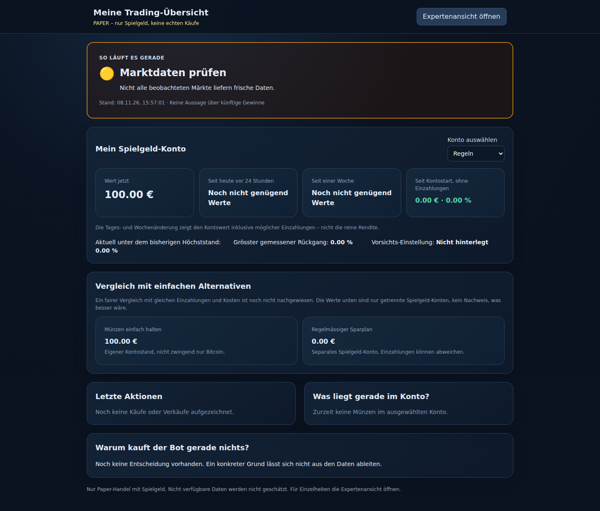
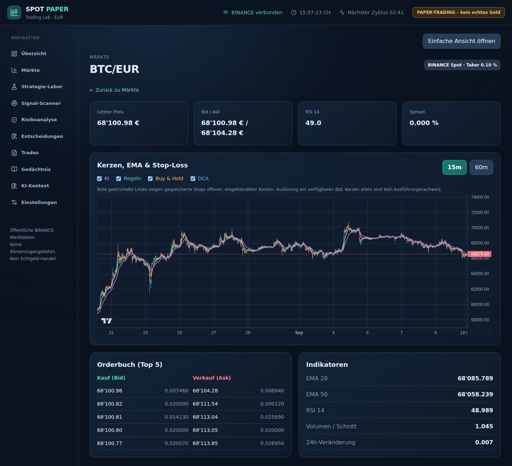
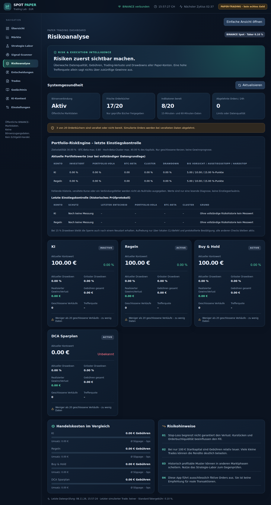
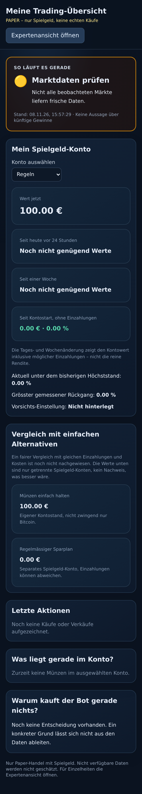

# Trading-Bot: Stand am 8. November 2026

> **Nur Paper-Trading:** kein Echtgeldhandel, keine API-Schlüssel, keine bezahlten Dienste. Ergebnisse sind keine Gewinnprognose.

## Wofür ist der Bot da?

Der Bot ist eine lokale Versuchsumgebung für Krypto-Spot-Trading. Sein Ziel ist, Strategien nach Gebühren und Risiken mit **Buy & Hold** und einem **Sparplan** zu vergleichen – nicht automatisch Geld zu verdienen.

- Lädt öffentliche Kurs- und Orderbuchdaten von Binance (optional Kraken); fehlende Daten werden als fehlend behandelt.
- Führt Käufe und Verkäufe in **Spielgeld-Konten** aus, einschliesslich geschätzter Gebühren und Slippage.
- Zeigt auf der **einfachen Startseite** eine Ampel, Kontowert, Positionen und letzte Aktionen.
- Bietet eine **Expertenansicht** mit Kerzenchart, Orderbuch, EMA/RSI und Handelsprotokoll.
- Prüft Positionsgrenzen, Portfolio-Risiken, Kursfrische und Notbremsen vor Einstiegen.
- Speichert historische Kerzen und kann Strategien rückwirkend testen (**Backtests**).
- Vergleicht Strategien mit Bitcoin-Halten und einem Sparplan; eine bessere Rendite ist **nicht** bewiesen.
- Protokolliert Forschungsentscheidungen und blockiert unzureichend geprüfte Strategien in der **Stage-Gate-Pipeline**.

## Was seit Anfang November entstanden ist

Die **CI** prüft Typen, Tests, Build und Kosten-/Schlüsselregeln automatisch. Das **Datenarchiv** und der Recorder können historische öffentliche Daten speichern; sie sind nicht mit vollständiger Live-Datenqualität gleichzusetzen. Die **Backtest-Engine** berücksichtigt Kosten und Ausführungsregeln. Die **Pipeline (#21)** hat aufeinanderfolgende Prüfstufen, die fehlende Belege nicht als bestanden werten dürfen. Die **Risk-Engine** begrenzt mögliche Verluste und Einstiege. Tests auf **Look-ahead** (keine Zukunftsdaten) und **Survivorship Bias** (auch historisch verschwundene Coins berücksichtigen) sollen falsche Testerfolge verhindern. Das Dashboard hat eine einfache und eine Expertenansicht inklusive Risikoübersicht. Vieles ist implementiert, aber noch nicht durch einen langen, unabhängigen Echtzeit-Paper-Lauf bestätigt.

## Nachprüfbare Kennzahlen

| Kennzahl | Ermittelt |
| --- | ---: |
| App-Code (Quellcode) | **18'615 Zeilen** |
| Tests (Quellcode) | **11'230 Zeilen** |
| Hilfsskripte (separat) | **3'243 Zeilen** |
| Erfolgreich ausgeführte Tests | **2'114** (2095 Vitest + 19 Node/Offline) |
| Gemergte PRs | **76** |
| Offene / geschlossene Issues | **30 / 36** |

Zählweise: physische Zeilen inklusive Leerzeilen in versionierten .ts/.tsx/.js/.mjs-Dateien. App = apps/server/src, apps/web/src und packages/shared/src; Tests = Testordner und *.test.* / *.spec.*; Skripte = scripts/ ohne Tests. Generierter Code, Abhängigkeiten und Marktdaten sind ausgeschlossen. Zahlen sind Momentaufnahmen des Erstellungslaufs.

## Schnelltest #33: Trendfolge 2020–2023

Unveränderte Werte aus dem [automatischen Kommentar in Issue #33](https://github.com/itslevinova-prog/Trading/issues/33#issuecomment-6721021908). Nur BTCUSDT/ETHUSDT, 2020-01-01 bis 2023-12-31; Signal bei Tagesschluss, Ausführung am nächsten Tages-Open. Kosten pro Trade-Seite: 10 bps Gebühr + 5 bps Slippage.

| Variante | CAGR | Max-Drawdown | Sharpe | Calmar | Trades | Exposure | Kosten/Start |
| --- | ---: | ---: | ---: | ---: | ---: | ---: | ---: |
| SMA50 | 67.16 % | 56.65 % | 1.290 | 1.186 | 148 | 53.56 % | 52.28 % |
| SMA100 | 62.16 % | 63.20 % | 1.175 | 0.983 | 108 | 57.73 % | 40.64 % |
| SMA200 | 79.79 % | 53.36 % | 1.358 | 1.495 | 38 | 52.33 % | 15.18 % |
| BTC Buy & Hold | 55.59 % | 76.63 % | 1.001 | 0.725 | 1 | 100.00 % | 0.15 % |
| BTC/ETH 50:50 Buy & Hold | 85.08 % | 77.81 % | 1.184 | 1.093 | 2 | 100.00 % | 0.15 % |

**Vorregistrierte Entscheidung:** GREEN – At least one fixed SMA window exceeds both reference Sharpe and Calmar

Daten-Hashes: BTC `ebd0a9d22354ebed0590146c2013f97bf9eb6e58abc27349b13b82b8fbd4cf4f`; ETH `2dd66f96180ec6d26caa4053e39ffc736c83c5831b66a6099fdb80848e2715a7`.

Der Schnelltest ist **nur ein Entwicklungstest**, keine unabhängige Validierung und kein Beweis für Profitabilität. Auch die hohen Kosten der aktiven Varianten sind zu beachten.

## Was noch fehlt – nächste Schritte

1. **Trendfolge #4** auf dem vorgesehenen vollständigen Coin-Universum mit realistischen Kosten prüfen, ohne nachträglich Ergebnisse schönzurechnen.
2. **Validierung 2024** erst gemäss vorab festgelegtem Verfahren durchführen; 2024 nicht zur Auswahl der Parameter nutzen.
3. **Pipeline #21** mit vollständigen Belegen und kosten-/risikoadjustierten Vergleichen gegen Buy & Hold und Sparplan durchlaufen.
4. Nur bei bestandenen Gates: **mindestens 90 Tage Paper-Trading** mit eingefrorener Strategie, Risikoüberwachung und Dokumentation. Erst danach überhaupt über weitere Schritte nachdenken.

## Screenshots der laufenden Paper-Oberfläche

Echte Playwright-Aufnahmen der auf einem GitHub-Runner gestarteten Anwendung im **Paper-Modus**, ohne API-Keys und ohne eingespielte Testdaten. Desktop-Viewport **1440 × 900**, iPhone-13-Emulation mit **deviceScaleFactor 2**. Die Expertenaufnahme zeigt die Coin-Detailansicht. Unvollständige Kurse/Indikatoren bleiben leer, wenn die öffentlichen Daten fehlen. Leere Felder bedeuten fehlende Daten, nicht null Risiko.

